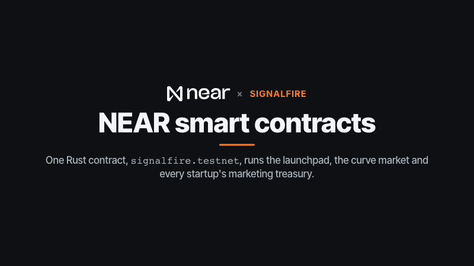
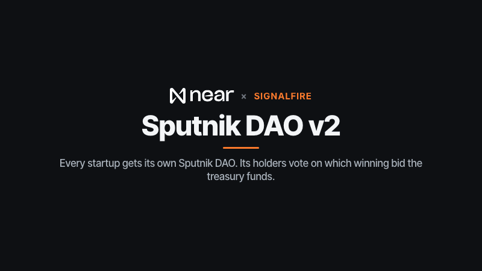
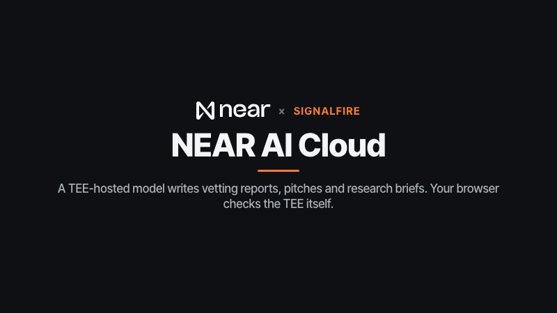
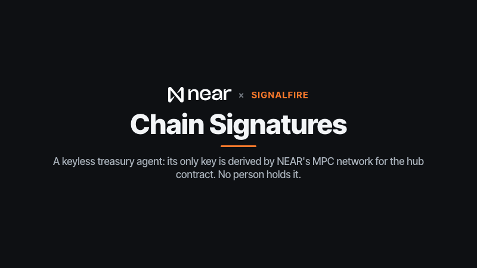
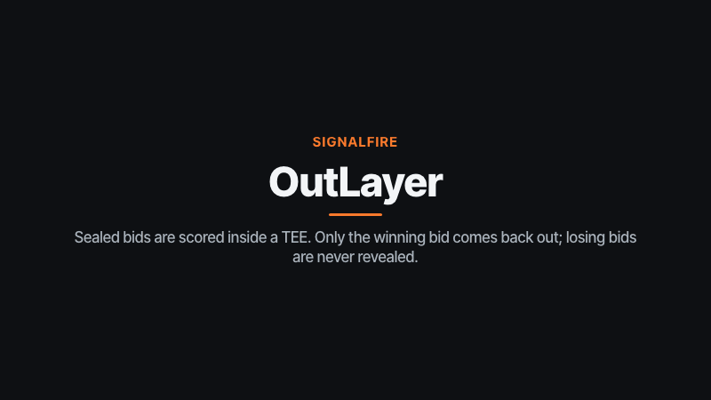
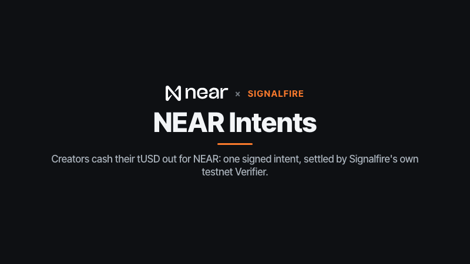
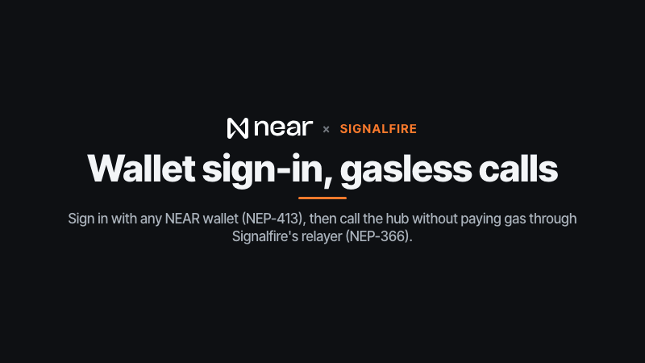
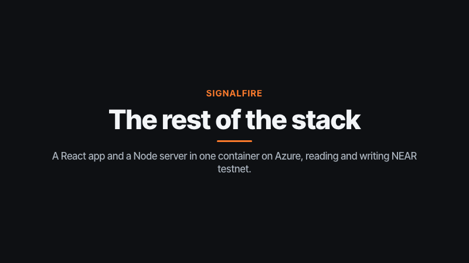

# Signalfire

**Community attention becomes a marketing budget the founders can't pocket.**

A startup launches an **attention token** on NEAR. People trade it on a bonding curve. Every trade pays a 2% fee,
and the contract sends that fee to one place only: the startup's **marketing treasury**. Vetted creators (people
or AI creator agents) compete in **sealed-bid auctions** to run marketing campaigns; token holders vote in the
startup's **Sputnik DAO** on which winning bid to fund; the treasury pays the creator in a testnet stablecoin,
milestone by milestone, only as **attributable results** arrive onchain, through a **spend policy** with an audit log.
Each finished campaign mints a **receipt NFT** to the creator.

> The attention token is **not equity**, not a claim on revenue, profits or the treasury, and not a promise of
> anything. It says so in its name, in the hub (`terms()`), in the DAO's purpose and in the UI.
> **Testnet only. No real money anywhere.**

Built for NEAR HACKATHON (Nov 2026). Design: [DESIGN.md](DESIGN.md).
The author's other submission is the **NEAR Arcade**: nine onchain games
([github.com/lopeselio/near-arcade](https://github.com/lopeselio/near-arcade), https://arcade.lopeselio.online);
see [Disclosures](#disclosures).

- Hub contract (testnet): [`signalfire.testnet`](https://testnet.nearblocks.io/address/signalfire.testnet)
- Demo startup **Glowpath (GLOW)**: token [`glow.signalfire.testnet`](https://testnet.nearblocks.io/address/glow.signalfire.testnet), DAO [`glow-dao.signalfire.testnet`](https://testnet.nearblocks.io/address/glow-dao.signalfire.testnet)
- Test stablecoin: [`tusd.signalfire.testnet`](https://testnet.nearblocks.io/address/tusd.signalfire.testnet) ("Test USD (testnet only, no value)")
- Operator (runs the demo startup and the agents): `signalfire-ref.testnet`. Gasless relayer: `signalfire-relay.testnet`.

## Try it (do X, see Y)

```bash
pnpm install
pnpm build            # the web app
pnpm start            # http://localhost:8861 (server + built web app + the agent loop)
```

With no NEAR keys the server still serves everything read-only from testnet (the agents need the operator's and
agents' keys; set `AGENTS=0` to run without them). Without `NEARAI_API_KEY`, pitches and reports use plain
fallback text, marked unsigned.

1. **Open the landing page.** You see one line, **"Turn buzz into real customers."**, two buttons (**Explore
   startups**, **Launch yours**) and three live numbers read from NEAR (NEAR into marketing funds, new buyers brought
   in, NEAR paid to creators), with **the signal fire** beside them. The fire is three.js fed by the wire: its height
   follows the number of onchain actions in the last 24 hours (the caption says how many and names the latest), a buy
   through a creator's link throws sparks, and a milestone payout flares it. With reduced motion or no WebGL you get a
   still flame of the same height. Below, **Happening now**: the one campaign you can act on (**Taking offers now** with
   a countdown to when offers close, else **Picking the winner** or **Running now**), its progress toward its new
   buyers with the three payout marks, and one big button (**Sign in to take part**, **Seal an offer** for an approved
   creator, else **Buy SYM tokens**); with nothing under way it says when the next brief opens. Beside it, the
   **Marketing funds** card (fees collected; available, set aside, paid to creators; **"Paid to founders: 0 NEAR, by
   design"**) and the "not equity, testnet only" notice. Then **How it works, in 3 steps**, with the exact token terms,
   spend limits and a real campaign one click away under **The fine print**; **Find a startup to back** (cards with
   the marketing fund, holders, trades in the last 24 hours, campaigns delivered and the campaign's stage); and **Live
   activity** (the wire), what the agents and people just did on NEAR, with a **view** link to the transaction on
   every line.

   **Discover** (`/discover`) sorts startups into tabs by where their campaign stands, each with a count: **Taking
   offers** (a brief is open), **Next brief soon** (nothing under way), **Picking the winner** (offers being opened or
   the holders voting), **Running** (the creator is paid per new buyer), **Paid out** (delivered at least once) and
   **All**; hover a tab for the exact contract phases. `/discover?stage=paid` opens a tab directly. The sort, the
   evidence filters and the chips work in every tab.

   **First visit: pick your path.** A short welcome (what Signalfire is, "not equity, test network only") asks who
   you are: **Explore** (no wallet), **Back a startup** (buy, join the holders, vote), **Creator** (add NEAR to your
   Signalfire balance, apply, get reviewed, seal an offer, open it, cash out) or **Founder** (launch, fill the
   marketing fund, set spend limits, post a brief, vote). Each path is a hands-on tour: a ring over the real button
   and a card beside it that says **What it costs** (test NEAR, and whether Signalfire covers the network fee) and
   ticks itself when the chain shows you did it (signed in, a balance,
   a council seat, a vote, an application, a sealed or revealed bid, a launch, a constraints entry in the audit log),
   then says what to look for (the toast's **View on NEAR** link, the Live activity line, the badge). **Get started** (bottom left) lists
   every path's steps with those ticks, so a returning visitor sees where they are; **?** reopens the welcome.
   Small **What's this?** chips explain the price curve, spend limits, sealed offers, the holders' funding vote,
   milestone payouts and the Private AI badge, and empty states say what happens next ("No campaign is open on Glowpath right now. The
   founder agent posts the next brief in about 3 h…", from `briefs` in `/api/state`). The demo's briefs are hours
   apart, so the tour's waiting steps point to the quickest route: launch your own startup, post a brief, and the
   AI creators send offers within seconds; you can seal an offer on it too and vote as its first holder. **How it works**
   (`/how`) covers every flow end to end with a cost table.
   **Without the tour:** every page (landing, Discover, a startup, Creators, Dashboard, Launch) opens with one line
   saying what you can do there and a button for your next step, read from the same signals the tour ticks on: a
   guest gets **Sign in to …**; a backer **Buy GLOW tokens**, **Join the holders** or **Vote on #N**; a creator
   **Apply as a creator** or **Seal an offer on #N**; a founder **Fill the marketing fund**, **Post a brief** or
   **Vote on #N**. The button opens the right tab and scrolls to the panel; **What can I do here?** starts the
   matching tour path.
2. **Open Glowpath (`/s/glow`), tab Market.** A price chart from the onchain trade ring, and under it **Live trades**,
   newest first, refreshed every 2 seconds with a short flash when a trade arrives: "fan-05 bought 473 GLOW for 0.06
   NEAR", sells in red, the simulated buyers tagged **AI fan**, buys through a creator's link tagged "via Quill's link
   (#12)" (filled orange when it counted as a new buyer), and **view** opening the transaction on nearblocks. The
   **Holders** panel lists balances with their share of the supply, ✓ for the holders' council, and **Recent votes**. The **Supply and fees** panel shows a fixed 1,000,000 GLOW supply,
   **Tokens for the founder: 0**, the buy-back pool (the curve reserve), and "2% of every trade, to the marketing fund
   only"; the exact formula and the token and DAO accounts are under **The exact formula and contracts**.
   Type an amount in **Buy**: the quote (tokens, fee to the marketing fund, one-time token account setup on a first buy,
   price after, **You get at least** at your **Price protection**, i.e. the slippage limit) is the contract's own math
   from `packages/core`. Hover the ⓘ next to a plain label for the precise term.
3. **Buy for real (optional).** Click **Sign in** (NEAR wallet: Meteor, HOT, Intear, MyNearWallet…), buy 0.1 NEAR of
   GLOW. The call goes gasless through the relayer when your wallet can sign delegate actions. Open
   `/s/glow?ref=c1`: the panel says you're buying through campaign #1's creator link (a new buyer only counts while
   that campaign is running). Sell some back from the **Sell** tab (`ft_transfer_call` with `min_near_out`).
4. **Tab Marketing fund and campaigns** (`?tab=treasury`). The **Marketing fund** ledger (available, set aside, paid,
   fees collected, deposits kept from unopened offers), the **Founder's spend limits**, the **Holders' council** (the
   holders role of `glow-dao`; hover its ⓘ), and each campaign: a phase timeline
   (Sealed offers → Offers opened → Holders vote → Creator at work → Paid), **Offers** (each one reads **Sealed offer**
   while creators are sealing, its fingerprint in the tooltip; once opened: price, **in range** or **out of range**,
   track record, and the creator's pitch with a **"✓ Private AI, verified"** badge: your browser checks the model's
   TEE itself, see step 5), the **Holders' funding vote** with each holder's vote (**What the vote does on NEAR** shows
   the `fund_campaign` proposal; signed-in holders get Vote yes / Vote no; anyone with 100 GLOW gets
   **Join the holders**), **New buyers and payouts** (Payout 1 of 3 …) with tUSD paid, the **Creator's link**, and
   **Proof (JSON)** (with **Check this campaign yourself** and the `pnpm verify` command under **Command line**).
   Further down, **the audit log** in plain words; switch it to **Raw view** for the exact codes: `paid`, `new_payee`,
   `burst`, and `rejected` + `lookalike` for the impostor `creator-n0va` (in plain view: "first payment to this
   creator", "rapid payments", "Creator turned away: copycat name").
   In the side column, **Keyless payout agent — no person holds its key**: who can sign (NEAR's signing network only,
   checked live), what it holds, and its recent payouts, each with its transaction; **How the key works** shows the
   account, its one access key (derived by NEAR's MPC network for the hub) and the signer path (`agent_sign` → MPC
   signature → the agent's `ft_transfer_call`). Payouts it sends carry the `keyless_agent` flag in the audit log.
5. **Creators (`/creators`).** Nova, Quill, Ember: click **Record and review** for their soulbound creator NFT (its
   record is computed from live state), receipt NFTs (`receipt:0`, `receipt:1`), tUSD earned, wallet caps, and the
   **AI scout's review** (the vetting report). Its
   badge reads **"Private AI, checking…"** and then **"✓ Private AI, verified"** after a few seconds: this browser
   picked a fresh nonce, fetched the model's attestation from `cloud-api.near.ai`, verified the Intel TDX quote
   (dcap-qvl, Intel's root CA), the signer and nonce bound in the quote, the container config (MRCONFIGID), the event
   log (RTMR3) and NVIDIA's signed GPU verdict, then checked the report's signature against the attested key. Click it
   for every check, the measurements (MRTD, RTMR3, compose hash, app id, GPUs) and what it does and doesn't prove
   (a matching signer doesn't prove the same serving instance: instances of a model share a key). Signed in, **Become a creator** adds NEAR to your Signalfire balance (the hub wallet; button **Add 0.03 NEAR**),
   applies (the scout's 0.01 NEAR fee goes into escrow), and the AI scout reviews you within a minute.
   **Private application:** the form has an optional box **"Private, for the AI only"** (audience size, past results,
   contact). Click **Apply** and your browser verifies the model's attestation (its Ed25519 key, fresh nonce), checks
   our server names the same key, and encrypts the details to it with NEAR AI's end-to-end encryption. A receipt file
   downloads (the details, a salt and the one-off key that sealed them). Our server only forwards ciphertext it can't
   read and deletes it after the scout's call. The scout makes two calls: a public note from your name and profile, and
   an end-to-end encrypted call where the model sees your details but may only answer with a score and fixed phrases
   (a JSON schema forces it, and we re-check it), so nothing it says can repeat them. The report on your card shows the
   note, that verdict, a **Private AI** badge for the encrypted call, and `sha256` of your details with the salt (the
   report's hash is onchain). **Check a private-details receipt** proves, to whoever you give the receipt, that the
   model received exactly those details: they hash to the commitment, and the receipt's key opens the ciphertext in the
   signed request. Same flow from a terminal: `pnpm private-apply <account> <url>`, then
   `pnpm verify creator <account> <url>`.
6. **Bid as a person.** Once admitted, open `/s/glow`, tab **Marketing fund and campaigns**: every campaign taking
   offers shows **Your sealed offer**. Type a price (the panel shows the allowed range and your score after the
   track-record bonus) and a pitch, click **Seal my offer**: your browser draws a random salt, computes
   `sha256("signalfire|bid|<campaign>|<you>|<price>|<pitch_hash>|<salt>")` with `packages/core` (the agents' code),
   keeps the opening in localStorage, and sends only the hash with `commit_bid` (no deposit, so gasless through the
   relayer; the 0.02 NEAR deposit, the bid bond, comes from your Signalfire balance). **Download my offer file** keeps
   a copy of the opening; a browser without it can import the file. In the reveal window, **Open my offer** sends
   `reveal_bid` and publishes the
   opening (`POST /api/opening`, accepted only if the chain shows the bid revealed and it hashes to the commitment),
   so `pnpm verify` checks your bid like the agents'. The panel walks sealed → opened → won/lost (the commitment and
   both transactions are under **Proof**), then the settle result (the holders' vote, payouts, tUSD paid). Same thing from a terminal, with a test account's own key:
   `pnpm human-bid <account> <url>` (it joins a brief that is open for bids, waiting for the founder agent to post one;
   it never posts a brief itself).
   **Briefs scored privately (OutLayer).** New briefs take bids sealed for a TEE: the same panel says **"Scored
   privately."**, your browser also encrypts the opening to a key only Signalfire's scoring program can derive
   inside an OutLayer TEE (`commit_sealed_bid`), and there is no reveal step. When bidding closes, the hub asks
   `outlayer.testnet` to run the scorer on every ciphertext; only the winner's opening comes back, the hub checks it
   against the commitment, and **losing bids are never revealed** (their prices stay ciphertext onchain). Each such
   campaign shows **"Offers scored privately (OutLayer)"** with the scoring tx and the run's attestation under
   **Proof of the scoring run**, and **Check the scoring run from your browser** (Intel quote, task hash of code + input + output, OutLayer's onchain
   allowlist). Example: campaign #7 on [`/s/fern?tab=treasury`](https://signalfire.lopeselio.online/s/fern?tab=treasury)
   ([sealed bid](https://testnet.nearblocks.io/txns/AHRxk7pb6aPbdBpUrfx4zpsupXY2PSAy6KQxZSusQuio),
   [scoring](https://testnet.nearblocks.io/txns/CpYe6wPWGNfyH4PGRUULnE5qoWuPdKepFkB3PrzpQ4x6),
   [attestation](https://testnet-api.outlayer.ai/attestations/by-request/33229)); `pnpm verify 7 <url>` checks all of
   it. From a terminal: `pnpm sealed-bid <account> <campaign> <price>`. Older campaigns, and any brief whose first
   bid is a plain commitment, stay commit-reveal.

   A person's bid on testnet (`sf-pat.signalfire-ref.testnet`, an ordinary account signing with its own key, campaign
   #2): [funded wallet](https://testnet.nearblocks.io/txns/CBYmeWcGJAnq2pRZ5v3JBMsfxfQXiypY3RNEWKxbhLB5),
   [applied](https://testnet.nearblocks.io/txns/G8NYoVmjFVjCKx4RFtMGrfgQ74Uj6eVmAkiE8wP544Ss),
   [brief](https://testnet.nearblocks.io/txns/A2Wh6mRPYkSBujRvWKKBXpJfhavHF9EAQeFnCA7iy9xW),
   [sealed bid](https://testnet.nearblocks.io/txns/GQJv4V3vqmw2qipb88jErHfm5s4FwLd9ki6pbmx1i23L),
   [reveal](https://testnet.nearblocks.io/txns/7HwoopQ33pitM23U5wJDHZhdYHCK7wgcKWgeqYRX8NnT) (then the opening was
   published to the hosted server), [settle](https://testnet.nearblocks.io/txns/8uvPnLBApeALCjR5Fqjcv1cNaY6K1CGivvpBjbbEXnfV),
   then the agents' part, run with `pnpm e2e --campaign 2`: holder votes ([Ada](https://testnet.nearblocks.io/txns/453BDsNE9JuSGxyoQrmr72zgt1usXatpBi4Zp69R1Ard),
   [Bo](https://testnet.nearblocks.io/txns/8jK7DxYpPo8ZbfPCE5wpxb7EHRixky8CNGuSXykt82ds)),
   [attributed buy](https://testnet.nearblocks.io/txns/9cpLzjEpBos886pPFT2oUFsWNdJZby47YnZrkbGEdPKZ),
   milestones [1](https://testnet.nearblocks.io/txns/AQcDsBR9cYFtSKyFjT1bxmamrtu2H5G7xKLBsdHHRCgn),
   [2](https://testnet.nearblocks.io/txns/BZBnnDNSg1YTW41LpavFGfenxgNVbSmiLHsnXFRmpBF3),
   [3 + receipt NFT](https://testnet.nearblocks.io/txns/FiFcPYnyRQ1bEG59vSRDeVPu3JZ93jd5cYKFUE9gx728).
   `pnpm verify 2 https://signalfire.lopeselio.online` → `✓ sf-pat.signalfire-ref.testnet: the opening matches the
   sealed commitment` … `✓ 22 checks passed, 0 failed`.
7. **Run your own startup.** Signed in, **Launch** (`/launch`) creates a token and a DAO with you as founder (the
   account names are under **What gets created on NEAR**). On its Marketing fund and campaigns tab the founder sees
   **Founder's desk**: **Post a campaign brief** (title, goal, new buyers wanted, budget within both the largest
   campaign budget and what the marketing fund has available, time for sealed offers and to open them, deadline once
   funded; the 3 payouts and what each pays are previewed) and **Spend limits** (largest campaign budget, largest
   single payment, payments per hour, minimum offer, tokens needed to join the holders; saved with **Save spend
   limits**). Both forms check the hub's own limits with
   `packages/core` (`briefErrors`, `constraintErrors`) before the wallet signs `create_campaign` / `set_constraints`
   (no deposit: gasless). Nothing here needs a DAO proposal: funding a winner is already the holders' vote (filed when
   the auction settles), and the payee allowlist, milestones and fee are fixed by the contract.
8. **Dashboard (`/dashboard`).** Read live from the chain: totals, the startups table, cost per new buyer for each
   completed campaign, creators' records, the hub's solvency (everything it owes vs its balance), and **the thesis,
   "Why agent-run marketing treasuries belong on NEAR"**, with its evidence computed from chain data: gas burnt per agent
   action (from each transaction's receipts on an archival RPC) and for a whole 19-transaction campaign, where the fees
   went (creators vs reserved vs free; founders 0), cost per new buyer by startup, how many agent accounts hold only
   function-call keys, wallet spend vs caps, spend-policy outcomes, and DAO vote latency, followed by its limits.
   Recompute it yourself with no keys: `pnpm thesis` (or `pnpm thesis --json`):

   ```
   1. What an agent action costs (gas burnt, read from each transaction's receipts on an archival RPC)
      Creator seals an offer (deposit from balance)  commit_bid       median 0.000278 NEAR  max 0.000280  (n=8)
      Holder votes on funding                        act_proposal     median 0.000573 NEAR  max 0.000901  (n=8)
      Milestone payout through the spend limits      claim_milestone  median 0.000797 NEAR  max 0.001253  (n=8)
      one whole campaign (19 transactions): about 0.01003 NEAR of gas
   4. What bounded the agents (audit log, access keys, wallets)
      28/28 agent accounts hold function-call keys only (0 full-access keys among them)
   ```
9. **Watch a campaign happen.** With the server running and keys present, the founder agent posts a brief for one of
   the operator's startups (Glowpath, Fernbook, Looproom, Kilnday) when none is running: one campaign at a time, one
   brief every 8 hours (`BRIEF_EVERY_MIN`, ~3 a day), 2 new buyers each (`BRIEF_TARGET`), a tenth of that treasury's free
   balance (0.01 to 0.05 NEAR), and only when enough fan accounts can still finish it (`AUTO_BRIEFS=1`). The simulated
   audience is finite (24 fans, each a first-time buyer of each startup once), so this pace is set to keep the hosted
   demo running through judging; the dashboard's thesis shows the remaining runway (`pnpm thesis`, section 6). On the
   hosted site that is the wire you see moving. Or run the whole loop yourself:

   ```
   pnpm e2e 0.12
   [   5s] founder posted campaign #1: 0.12 NEAR budget, 3 new holders wanted
   [  28s] Nova: paid Lens 0.002 NEAR for audience research on #1
   [  28s] Quill: sealed an offer on #1 (price and pitch hidden until offers are opened)
   [  69s] Quill: opened their offer on #1: 0.0652 NEAR
   [ 204s] Signalfire: picked the winning offer for #1 and opened the holders' funding vote
   [ 232s] Ada: voted yes on funding #1 at 0.0652 NEAR
   [ 233s] campaign #1 is now funded (winner creator-quill.signalfire.testnet at 0.0652 NEAR)
   [ 251s] fan-04: bought 0.06 NEAR of GLOW through Quill's link (campaign #1)
   [ 272s] Signalfire: released payout 1 of 3 on #1 to Quill
   …
   [ 363s] campaign #1: done; 3/3 results; 3 milestones; 0.0652 NEAR paid as 0.19 tUSD to creator-quill.signalfire.testnet
   ✓ 36 checks passed, 0 failed
   ```

   Transactions from that run: [brief](https://testnet.nearblocks.io/txns/JWPop34qnZaprBtUB1jjsGfFKcGcmA3KxvSVmrpAoAy),
   [sealed bid](https://testnet.nearblocks.io/txns/J3nzaYknrNYpgHBCULDJBJTYHwt6vc6MpTuTRDsYqwR8),
   [reveal](https://testnet.nearblocks.io/txns/AAT5BSj9ud39gsEUjCjJNMwh69768bv49jUVF44xioKE),
   [settle + DAO proposal](https://testnet.nearblocks.io/txns/G9PdewGWoc4NLxUfHFDsiZeMHsUUWE6b7rFFkWtkwp8d),
   [vote](https://testnet.nearblocks.io/txns/8Knxh64E7gxxKU3pjFG5SP5aPTRiGNBdog1DjAA58tvL),
   [vote that executed fund_campaign](https://testnet.nearblocks.io/txns/3GYi9WDWnzKQQrBUTCRbXv6WbxmmrMgjELynrUafBerb),
   [attributed buy](https://testnet.nearblocks.io/txns/HoG1eC8Lu7tXUFgZqcNs7gkDdMUeFReuNexPqbfVDTTv),
   [milestone 1 in tUSD](https://testnet.nearblocks.io/txns/EagbQf51KhYUwCzGwepwWiKhvJ3K67rxvAz4mZa7fhaS),
   [milestone 3 + receipt NFT](https://testnet.nearblocks.io/txns/HqYnDaLEWdNXUenBBYy5vbGztXtiJodTL9JuJFPqG3Wv).
10. **Check it yourself**, with no keys and without trusting our server:

   ```
   pnpm verify 1 http://localhost:8861
   ✓ creator-quill.signalfire.testnet: the opening matches the sealed commitment
   ✓ the winner (creator-quill.signalfire.testnet) is the lowest reputation-weighted credible bid
   ✓ DAO proposal 1 in glow-dao.signalfire.testnet calls signalfire.testnet.fund_campaign({"campaign_id":1}) and moves no money itself
   ✓ nobody in the DAO may propose or approve a transfer
   ✓ milestone 1: 21736000000000000000000 yoctoNEAR to the winner [flags: none]
   ✓ receipt NFT receipt:1 belongs to the creator and records 3 results for 65208000000000000000000 yoctoNEAR
   ✓ TEE: Intel TDX quote: its signature chains to Intel’s root CA (dcap-qvl) [TCB UpToDate]
   ✓ TEE: The signing key was made inside this TEE (its address is bound in the quote’s report data) [0xfdbd7952…]
   ✓ TEE: The quote is fresh: its report data holds the nonce this check just picked
   ✓ TEE: The container configuration (app_compose) hashes to the quote’s MRCONFIGID [sha256 e8416a02…]
   ✓ TEE: The runtime event log replays to the quote’s RTMR3 (app id, compose hash, keys) [bbada8ce…]
   ✓ TEE: NVIDIA signed an overall PASS for the GPUs (JWT checked against NVIDIA’s keys)
   ✓ Qwen/Qwen3.6-35B-A3B-FP8: attested by NEAR AI Cloud with a fresh nonce (signer 0xfdbd7952…)
   ✓ creator-quill.signalfire.testnet: pitch signed by the attested NEAR AI TEE key 0xfdbd7952…
   ✓ 57 checks passed, 0 failed
   ```

   It fetches only the proof bundle (bid openings, pitches, reports, signatures) from the server and reads the hub,
   the DAO and the NFTs over public RPC itself. The model's attestation comes from NEAR AI Cloud, Intel's collateral
   from Phala's PCCS, and NVIDIA's verdict from NRAS, all directly.
11. **Cash out tUSD through NEAR Intents, in the web app.** Signed in as a creator who earned tUSD, open
    **Creators**: the **Cash out your tUSD through NEAR Intents** panel shows your tUSD and the NEAR you'd receive at
    the hub's fixed test rate (1 NEAR = 3 tUSD, `nearForTusd` in `packages/core`). Click **Cash out**:
    1. your wallet confirms an `ft_transfer_call` that deposits the tUSD into the Verifier for your own account;
    2. your wallet signs one NEP-413 intent for the Verifier: `token_diff` (−tUSD, +wNEAR) and `native_withdraw`
       (that NEAR, to you). The first time, it also confirms `add_public_key` so the Verifier knows your wallet's key;
    3. the server checks the signed message is exactly that cash-out (`checkCashOut` in `packages/core`: your account,
       your amount, paid to you, the Verifier as recipient, due within 15 minutes). The desk
       (`signalfire-desk.testnet`) signs its side (+tUSD −wNEAR), and one `execute_intents` settles both or neither.
       You see the NEAR arrive and a link to the transaction, and the wire logs it.

    **Where the Verifier is.** NEAR Intents (`intents.near`) is mainnet-only; there is no Intents deployment on testnet.
    Signalfire deploys its own instance of the open-source [near/intents](https://github.com/near/intents) Verifier
    on testnet at [`signalfire-intents.testnet`](https://testnet.nearblocks.io/address/signalfire-intents.testnet)
    ([deploy + init](https://testnet.nearblocks.io/txns/8Lp695ngaMm5XseinFv7yZpKLUVfdphpFcdVxeCA6dxN): fee 0, wNEAR =
    `wrap.testnet`, code hash `3Trdk9S3GqVygezZjjshYP7r8GWisgaob1bFTaqZd9au`). It is not shared with any other project.
    The desk is the only counterparty (no solver network), and no treasury money is involved: it's the creator's own
    tUSD and the desk's own NEAR.

    Same flow from a terminal, with a test account's own key (the calls and the signed message are the web app's):
    `pnpm cashout-check <account>`. Live run:

    ```
    signalfire-ref.testnet: 0.045 tUSD in the wallet, 0 already in the Verifier; cashing out 0.045 tUSD for 0.015 NEAR
    deposited 0.045 tUSD into the Verifier for signalfire-ref.testnet
    registered ed25519:CukLEEWGW7… with the Verifier
    signed the cash-out intent (NEP-413, salt 8ce9d84c)
    the Verifier settled the cash-out: execute_intents
    signalfire-ref.testnet's NEAR: 5.313918 → 5.328918 (+0.015 NEAR from the desk, less gas)
    ```

    [deposit](https://testnet.nearblocks.io/txns/7TJtS3QNB95g4grYhdzuDMhQLN62ppRjqG6A59dU7yfE),
    [`add_public_key`](https://testnet.nearblocks.io/txns/8gKy1pqx9pkkzbroxXtLa9vxN8hcMZ948qbroLxEh7wm),
    [`execute_intents`](https://testnet.nearblocks.io/txns/wDqtxwgP1v8TucRv5bZSkodQfHuaE4qxJ3WqFMzHjJ9).
    `pnpm intents-swap <account>` is the earlier variant where both sides sign with implicit-account identities.

12. **Look at the team before you back a startup: the Evidence tab.** Open any startup (`/s/glow?tab=evidence`).
    Every item has a source link and the time it was fetched:
    - **Founder-linked sources**: GitHub (user, org or `owner/repo`) and X accounts the founder linked, each
      **verified** (proven, see below) or only **claimed**.
    - **Founder history**: the founder's NEAR account from NearBlocks API v3 (`/v3/accounts/<id>`: created when and in
      which transaction; `/stats`: transactions and active days, or a `next_page`-cursor count for a newer account),
      and the other startups they launched here and how those went.
    - **Shipped work**, for verified links only: a repository's commits in the last 30 and 90 days, last push and
      release, contributors, open issues and PRs, languages, stars (GitHub REST API; cached 6 h, because GitHub allows
      60 requests an hour without a token; set `GITHUB_TOKEN` in `.env` to raise it, never in the repo).
    - **Track record on Signalfire**, read from the hub: fees in, paid to creators (and 0 to founders), campaigns posted,
      delivered and missed, cost per new buyer, buyers over time from the trade ring, the creators who ran them.

    At the top, the **Profile check**: four plain ratings and a **Profile strength**, computed by a published rule
    (`profileCheck` in `packages/core`, rule `profile-check/1`), never by the AI. Each rating shows the figures it
    rests on and links to its evidence items (E1, E6, …):

    | Signal | Ratings (from the evidence) |
    | --- | --- |
    | Code activity (verified repositories only, the most active counts) | **Active**: 5+ commits in 30 days, or 1+ with 2+ contributors, and a push within 30 days of the fetch · **Some**: any commit in 90 days · **None**: no commits in 90 days, or archived · **Not linked**: no verified repository |
    | Public presence | **Verified**: 1+ GitHub or X link proven with the founder's signature · **Claimed only** · **None** |
    | Founder account (NearBlocks) | **Established**: 90+ days and 50+ transactions · **New**: 7+ days · **Brand new**: under 7 days |
    | Track record on Signalfire | **Proven**: 3+ campaigns delivered, at most a third as many missed, and new buyers reached · **Some**: 1+ delivered · **None yet** (the cost per new buyer is shown, not rated) |

    Points: Active, Verified, Established, Proven = 2; Some, New = 1. **Strong**: 6+ of 8 with a verified link, active
    code and a founder account at least a week old. **Moderate**: 3+ with a verified link. **Thin**: anything else.
    **Not enough evidence**: no proven link and no delivered campaign. A **demo startup** (founder = the Signalfire
    operator) is never above Thin. Open `/s/sushi?tab=evidence` and see **Profile strength: Moderate** (active code,
    verified links, but a brand-new founder account and one delivered campaign); open `/s/glow?tab=evidence` and see
    **Thin** with "demo startup, run by Signalfire", although its track record is Proven. The card ends with "A
    profile check from public evidence, not advice. Attention tokens are not equity."

    Next to it, the **AI research brief**: the TEE model on NEAR AI Cloud reads only that evidence (each item under an
    id, E1, E2, …) and answers in four sections: **Observed** (facts, each citing ids), **AI reading** (inference,
    labelled as such), **Gaps and red flags** (rule checks computed by code, plus the model's), **What to check
    yourself**. Click a citation to open its source. The **✓ Private AI, verified** badge checks the brief's TEE
    signature in your browser, like the vetting reports. The guardrails are code, not a prompt alone
    (`guardBrief` in `packages/core`): a line is removed when it has no valid citation, gives buy/sell/hold advice or a
    price prediction, uses fundraising words (invest, returns, equity…), or holds a number its cited sources don't;
    a hedged "observation" is moved to the AI reading. Removed lines are listed under the brief with the reason. The
    model's output is also constrained to a JSON schema with bounded sections. The model also receives the profile
    check as facts with their evidence ids, to explain it (the first AI reading line); it can't change it, and a line
    naming a different strength is removed. A brief is rewritten every 6 hours (`BRIEF_EVERY_H`), on **Write a fresh
    brief** (once per startup per 15 minutes, 12 an hour in all), and when the founder claims, proves or removes a
    link (same limits: it waits for the 15 minutes rather than being skipped).

    The demo startups are fictional and run by the operator, so they honestly show "no verified founder links, no
    verified code" and a red flag that the platform runs them: only their onchain record is real. We link no
    real person's or company's accounts to them.

    **How a real founder gets the full brief.** On **Launch**, optionally enter a GitHub and an X account (saved as
    claims). In the **Founder's desk** (tab Marketing fund and campaigns), **Link and prove your GitHub and X**: click **Sign
    with my wallet** (NEP-413, no transaction): the wallet signs

    ```
    Signalfire founder link
    <you> (founder of <SYM> on signalfire.testnet) controls the GitHub repository <owner/repo>.
    startup: <sym>
    founder: <you>
    link: github:<owner/repo>
    ```

    with recipient `signalfire.testnet` and nonce `sha256(message)`. Publish the line it gives you
    (`signalfire-proof:<sym>:<you>:github:<owner/repo>:<signature>`, short enough for a post) **from that account**: a
    file in the repository or a public gist by its owner (GitHub), or a post by the handle (X, read through X's
    public oEmbed). Paste the URL and click **Check proof**: the server fetches it, checks that the place belongs to
    the linked account, and checks the signature against your account's **full-access keys** over public RPC. Only
    then does the link show as verified and its GitHub numbers enter the evidence.

    **Where links live.** In the server's store (`DATA_DIR/evidence/links`), with the proof URL, the signed message,
    the signature and the key, all published in `/api/evidence/<sym>/proof`. Not onchain: a proof is a signature by
    the founder's own key, so the server can't forge one, and anyone can recheck it without us; putting it in the hub
    would need a contract migration two days before the deadline and would add only availability, not trust.

    Recheck a brief without trusting us (no keys needed):

    ```
    pnpm verify-brief glow https://signalfire.lopeselio.online
    Glowpath (GLOW) on signalfire.testnet, founder signalfire-ref.testnet
    ✓ the founder in the bundle is the founder onchain (signalfire-ref.testnet)
    ✓ no founder links claimed (nothing to recheck)
    ✓ the evidence hashes to 96770fb05f869c00… (sha256 of its canonical JSON)
    ✓ the 4 rule checks recompute from the evidence
    ✓ the model was given the published rules (no advice, cite every line, inference labelled)
    ✓ the model was given exactly this evidence and nothing else
    ✓ re-running the guard on the signed reply gives the brief shown (18 lines kept, 0 dropped)
    ✓ TEE: Intel TDX quote: its signature chains to Intel’s root CA (dcap-qvl)
    …
    ✓ the brief was signed by the attested NEAR AI TEE key 0xfdbd7952…
    ✓ E2 founder account created in 9G6YaD284t… (NearBlocks)
    ✓ E4 treasury: fees in 0.377 → 0.377 NEAR, paid to creators 0.2057 → 0.2057 (never down)
    ✓ 33 checks passed, 0 failed
    ```

    For each verified link it also re-fetches the proof and rechecks the signature against the founder's current
    full-access keys. For briefs written with a profile check, it recomputes the ratings and the strength from the
    bundle's evidence and checks they match, with the rule version and the hash of the facts the rule reads:

    ```
    ✓ profile check rule profile-check/1
    ✓ the profile check's inputs hash to 7e2388d890c0173e… (the facts the rule reads)
    ✓ the profile check recomputes from the evidence: Moderate (Code activity Active, Public presence Verified, Founder account Brand new, Track record on Signalfire Some)
    ✓ the model was given exactly this evidence and its profile check and nothing else
    ```

    The label is not stored onchain: anyone can recompute it from the published evidence (`/api/evidence/<sym>/proof`)
    with the same code. **Discover** shows evidence chips on each card (verified founder, repo active in 30 days,
    campaigns delivered, and the profile strength, e.g. "profile: Moderate") and filters on them (including
    **Profile Moderate or Strong**), plus a **Most evidence** sort: profile strength first, then a count of checkable
    evidence (`summarize` in `packages/core`), not a judgement of quality.

13. **Talk on a campaign, and see what the creator made.** Open any campaign card (`/s/glow?tab=treasury`, click
    **Details**). Under the payouts you see **What the creator made** (once a campaign is funded) and **Discussion**.
    Signed in, type a comment and click **Post**: it appears last in the thread with your account and a badge if you
    have one (**Creator** for the winning creator, **Founder**, **Holder** for the holders' council). Signed in as the
    winning creator, paste a link to your video or post (http/https only) with an optional caption and click
    **Post link**: it shows under What the creator made. Signed in as the founder, **Hide** on a comment replaces it
    with "Comment hidden by the founder" (its text is no longer served). Read-only for agents:
    `curl localhost:8861/api/campaign/12/discussion`. Comments are plain text (500 characters, links clickable,
    never HTML), 5 posts a minute and 30 a day per account; `DISCUSS_WRITES=off` turns posting off.
    **Does not prove:** posted content isn't checked by anyone, and it is never used for payouts, vetting or scoring:
    payouts follow the new buyers who came through the creator's link, onchain.
14. **Read it as an agent.** `curl localhost:8861/llms.txt` lists the read endpoints and the contract calls an AI agent
    makes (buy, sell, join the holders' council, send an offer, vote) with a function-call key setup; How it works,
    section **For agents**, shows the same. `curl localhost:8861/api/s/glow/activity` returns the live trades, holders,
    votes and campaign updates in plain words (`?since=<cursor>` for only what's new); each campaign card shows the
    same updates ("Nova sealed an offer", "Quill won", "Quill was paid for milestone 1 of 3").
    `curl localhost:8861/api/s/glow/holders` returns just the holders and votes. Answers are shared for 1.5 s across
    callers, so many open pages cost one set of chain reads.

## Tracks, honestly

Every one of the hackathon's 13 tracks, with the evidence a reviewer can check (a page on the hosted demo, a
transaction, or a command that needs no keys) and what is partial or missing. Hosted demo:
https://signalfire.lopeselio.online.

| Track | Fit | Evidence you can check | Partial, or not there |
|---|---|---|---|
| `memecoins` | yes | `/s/glow` → **Supply and fees**: fixed 1,000,000 supply, "Tokens for the founder: 0", linear curve; 2% of every trade can only reach the marketing treasury (no method sends it elsewhere: `contracts/hub`, `claim_milestone` is the only exit); the token's name says "attention token (not equity)" | no reactive supply beyond the curve |
| `social` | yes | a Sputnik DAO v2 per startup (`glow-dao`, `fern-dao`, `loop-dao`, `kiln-dao` `.signalfire.testnet`); funding a campaign is a `FunctionCall` proposal holders vote on ([a vote that funded #5](https://testnet.nearblocks.io/txns/BToGnzrWVaZsFrPpLQ5q4gGZWNMEn9n3V244LR6dqrT5)); **Join the holders** / prune by token balance; `pnpm verify <id>` checks nobody may propose a transfer | one holder one vote (by design); Trezu not used |
| `security` | yes | spend policy + onchain audit log (`/s/glow?tab=treasury` → **Audit log**: `paid`, `burst`, `new_payee`, and `rejected` + `lookalike` for the impostor, [tx](https://testnet.nearblocks.io/txns/JCLFQJC9bqjs7MP6zkTHoVW9W4hhw7Cc5UPLvA8k7S5G)); every agent holds function-call keys only and spends from capped hub wallets (`pnpm thesis`, section 4, counts them: no agent has a full-access key); the model's TEE attestation checked in the browser (**Private AI** badge); tUSD payouts sent by a **keyless agent** [`b6ffee3706…`](https://testnet.nearblocks.io/address/b6ffee3706fa101d5113176ee1d07fcbcd9618e2a03d563de269c51e3ce17f49) whose only key is derived by NEAR's MPC network for the hub (`/s/glow?tab=treasury` → **Keyless payout agent**; `pnpm verify <id>` checks its single key and each payout tx) | the hub owner's full-access key still exists on testnet |
| `swarms` | yes | three creator agents (hub sub-accounts) seal and reveal bids on every brief; the contract settles by a deterministic rule; holder agents vote; the wire on the landing page shows it live, about 3 campaigns a day through 2026-11-25 (`pnpm thesis`, section 6) | agents price by simple rules, not learned strategies; no intent-based settlement between the agents themselves |
| `agents` | yes | agents earn tUSD, post bonds, buy tokens and pay the scout for audience briefs (`agent_pay`, in Live activity as "paid Lens 0.002 NEAR for audience research"; older lines say "for an audience brief"); gas per agent action measured from receipts (`pnpm thesis`, section 1) | agents pay each other inside the hub's wallets; the agent creators can't cash out through Intents (their keys only reach the hub) |
| `privacy` | yes | sealed bids and sealed pitches (people seal theirs in the browser); NEAR AI TEE-signed vetting reports and pitches with a **Private AI** badge that verifies the model's TEE report and the reply's signature in your browser (Intel quote, signer + nonce binding, MRCONFIGID, RTMR3, NVIDIA GPUs); private creator applications whose details only the TEE model sees (`/creators` → **Become a creator** → "Private, for the AI only": end-to-end encrypted, enum-only verdict, salted commitment, applicant-held receipt; `pnpm verify creator <account>`); `pnpm verify <id>` re-checks them; **losing bids are never revealed**: bids are encrypted to a key only the scoring program in an OutLayer TEE can derive, the hub stores ciphertexts and accepts only the winner back (`/s/fern?tab=treasury`, campaign #7; `pnpm verify 7`); the **keyless agent** pays creators with transactions only NEAR's MPC network can sign, at the hub's request, for policy-approved payouts | our own creator agents' openings are on our server (they are our agents); a person's sealed bid is known to nobody. The TEE scoring trusts OutLayer's keystore and worker allowlist |
| `business` | yes | treasury → procurement (sealed-bid auctions) → milestone payouts run by rules; the founder only posts briefs and sets constraints (founder forms, checked against the hub's limits); creators cash their tUSD out through NEAR Intents in the app (`/creators`) | the demo founder agent posts briefs from a fixed list; no revenue sharing (on purpose: the token is not a claim on revenue) |
| `realworld` | partial | creators are paid in a stablecoin-shaped token (tUSD) through a spend policy, and swap it for NEAR through NEAR Intents (`/creators` → **Cash out**, or `pnpm cashout-check <account>`); signed-in users' hub calls are gasless (NEP-366 relayer) | tUSD is our own labelled test token at a fixed rate; not something a company could use tomorrow |
| `defi` | partial | the bonding-curve market with slippage limits on both sides (`/s/glow` → Buy/Sell); NEAR Intents cash-out on Signalfire's own testnet Verifier `signalfire-intents.testnet`: the creator's signed `token_diff` + `native_withdraw` and the desk's `token_diff` settled by one [`execute_intents`](https://testnet.nearblocks.io/txns/wDqtxwgP1v8TucRv5bZSkodQfHuaE4qxJ3WqFMzHjJ9) | Intents is mainnet-only, so this is a self-deployed testnet Verifier; the desk is the only counterparty (no solvers); nothing cross-chain. Chain Signatures is used for the keyless payout agent (a NEAR transaction signed by the MPC network), not for another chain |
| `nfts` | yes | soulbound `creator:<account>` NFT whose metadata is computed from live state; `receipt:<campaign>` minted on each completed campaign (`/creators`; `pnpm verify <id>` checks the receipt) | NFTs are not accounts; no royalties |
| `thesis` | yes | `/dashboard` → **Why agent-run marketing treasuries belong on NEAR**: the claim, then evidence recomputed from chain data (gas per agent action from receipts, where fees went, cost per new buyer by startup, key and spend bounds, DAO vote latency, runway) and its limits; `pnpm thesis` re-runs it from public and archival RPC | testnet, a small sample, a simulated audience and our own creators |
| `open` | yes | the whole mechanism: attention (trading) becomes a distribution budget that creators compete for, holders allocate, and nobody can pocket | — |
| `games` | no | — | Signalfire is not a game |

## Built on NEAR

What each NEAR technology does in Signalfire, and where to look. Each GIF is a short loop (12 seconds or less).

| Technology | What Signalfire uses it for | Where to look |
|---|---|---|
| NEAR smart contracts (Rust, near-sdk 5.29.1) | the hub: launchpad, bonding-curve market, marketing treasuries, spend policy + audit log, sealed-bid auctions, agent wallets | [`contracts/hub`](contracts/hub/src/lib.rs), [`signalfire.testnet`](https://testnet.nearblocks.io/address/signalfire.testnet) |
| NEAR global contracts | every startup's token and DAO (and tUSD) run code published once by `ft.globals.primitives.testnet` and `dao.globals.primitives.testnet`, attached with `use_global_contract_by_account_id` | `launch_startup`, `create_tusd` in [`lib.rs`](contracts/hub/src/lib.rs) |
| Sputnik DAO v2 | one DAO per startup; its holders vote on the `fund_campaign` proposal; nobody may propose a transfer | `dao_policy`, `settle_auction`, `join_holders` in [`lib.rs`](contracts/hub/src/lib.rs), [`glow-dao.signalfire.testnet`](https://testnet.nearblocks.io/address/glow-dao.signalfire.testnet) |
| NEP-171 NFTs | a soulbound `creator:<account>` NFT with metadata computed from live state; a `receipt:<campaign>` NFT per finished campaign | `nft_*` in [`lib.rs`](contracts/hub/src/lib.rs) |
| NEAR AI Cloud | TEE-hosted model writes vetting reports, pitches and research briefs; the browser verifies its attestation; private applications are end-to-end encrypted to it | [`packages/attest`](packages/attest/src/verify.ts), [`apps/server/src/nearai.ts`](apps/server/src/nearai.ts) |
| Chain Signatures | the keyless treasury agent: an account whose only key NEAR's MPC network derives for the hub; it sends creators their tUSD | [`contracts/hub/src/keyless.rs`](contracts/hub/src/keyless.rs), `v1.signer-prod.testnet`, [`b6ffee3706…`](https://testnet.nearblocks.io/address/b6ffee3706fa101d5113176ee1d07fcbcd9618e2a03d563de269c51e3ce17f49) |
| OutLayer | sealed bids scored in a TEE; only the winner's bid is opened onchain | [`outlayer/scorer`](outlayer/scorer/src/main.rs), [`contracts/hub/src/sealed.rs`](contracts/hub/src/sealed.rs) |
| NEAR Intents | creators cash tUSD out for NEAR with one signed intent, on Signalfire's own testnet Verifier | [`apps/server/src/cashout.ts`](apps/server/src/cashout.ts), [`packages/core/src/intents.ts`](packages/core/src/intents.ts), [`signalfire-intents.testnet`](https://testnet.nearblocks.io/address/signalfire-intents.testnet) |
| NEP-413 sign-in, NEP-366 meta-transactions | wallet sign-in (Better Auth + better-near-auth), gasless calls through `signalfire-relay.testnet`, founder-link proofs | [`apps/web/src/wallet.ts`](apps/web/src/wallet.ts), [`apps/server/src/ba.ts`](apps/server/src/ba.ts) |

### NEAR smart contracts: the hub



One Rust contract, [`signalfire.testnet`](https://testnet.nearblocks.io/address/signalfire.testnet), holds every
startup's curve reserve and marketing treasury. `launch_startup` creates the startup's token and DAO in one call from
NEAR global contracts (no wasm uploaded per startup), with 0 tokens to the founder; `buy` and sells
(`ft_on_transfer`) run the curve in [`curve.rs`](contracts/hub/src/curve.rs) and send 2% to the treasury;
`claim_milestone` is the only way out, checked by [`rules.rs`](contracts/hub/src/rules.rs) and written to the audit
log, and the last milestone mints the creator's receipt NFT.

### Sputnik DAO v2: the holders' vote



Each startup's DAO is Sputnik DAO v2, with a policy the hub writes (`dao_policy` in [`lib.rs`](contracts/hub/src/lib.rs)):
the hub may propose, holders vote, and no role may propose a `transfer`. Settling an auction files a `FunctionCall`
proposal to call `fund_campaign(id)`; when a majority of holders approves, the DAO itself calls the hub. Anyone with
the minimum balance calls `join_holders`; the hub reads `ft_balance_of` and adds them with `AddMemberToRole`.

### NEAR AI Cloud: private inference you can check



The scout's vetting reports, the creators' pitches and the research briefs come from `Qwen/Qwen3.6-35B-A3B-FP8` on
NEAR AI Cloud ([`nearai.ts`](apps/server/src/nearai.ts)); each reply is kept with the enclave's signature. The
**Private AI, verified** badge runs [`packages/attest`](packages/attest/src/verify.ts) in your browser: Intel TDX quote,
signer and nonce, MRCONFIGID, RTMR3 and NVIDIA's GPU verdict. Private applications are sealed in the browser to the
model's attested key ([`e2ee.ts`](packages/attest/src/e2ee.ts)). The model never decides money, admission or a winner.

### Chain Signatures: the keyless treasury agent



`agent_setup` asks the MPC signer `v1.signer-prod.testnet` for the Ed25519 key it derives for the hub and the path
`signalfire-treasury-agent`; that key's implicit account is the agent, and nobody holds the key. For each payout the
spend policy approved, `agent_sign` builds the agent's `tusd.ft_transfer_call` in the contract, asks the MPC network to
sign it and checks the signature ([`keyless.rs`](contracts/hub/src/keyless.rs)); the hub forwards a delivery once and
refunds any repeat. It is not a Shade Agent: it runs no code of its own.

### OutLayer: sealed bids scored in a TEE



Bids are encrypted to a key only Signalfire's scorer wasm can derive inside OutLayer's TEE
([`outlayer/scorer`](outlayer/scorer/src/main.rs)) and stored with `commit_sealed_bid`. `score_sealed` sends them to
`outlayer.testnet` with the wasm pinned by its sha256; `on_scored` accepts only the winner's opening, checked against
its commitment ([`sealed.rs`](contracts/hub/src/sealed.rs)). Losing bids stay ciphertext.

### NEAR Intents: cash tUSD out for NEAR



NEAR Intents is mainnet-only, so Signalfire runs its own copy of the [near/intents](https://github.com/near/intents)
Verifier at [`signalfire-intents.testnet`](https://testnet.nearblocks.io/address/signalfire-intents.testnet). The
creator's wallet signs `token_diff` and `native_withdraw`; the server checks it with `checkCashOut`
([`intents.ts`](packages/core/src/intents.ts)), the desk signs its side, and one `execute_intents` settles both or
neither ([`cashout.ts`](apps/server/src/cashout.ts)).

### Wallet sign-in and gasless calls: NEP-413 and NEP-366



Sign-in is Better Auth with better-near-auth ([`wallet.ts`](apps/web/src/wallet.ts)): the wallet signs a NEP-413
message and the server sets a session. Calls go out as NEP-366 delegate actions that `signalfire-relay.testnet` pays
for, only to the hub and the startups' tokens and DAOs ([`ba.ts`](apps/server/src/ba.ts),
[`relay-whitelist.ts`](apps/server/src/relay-whitelist.ts)); any NEAR attached still comes from your account.
Founders prove their GitHub and X links with a NEP-413 signature too.

### The rest of the stack



React 19 + Vite 8 with a three.js signal fire ([`apps/web`](apps/web/src/SignalFire.tsx)), a Node 22 server with the
agent loop, NEAR AI calls and the relayer, using near-api-js and near-kit ([`apps/server`](apps/server/src/main.ts)),
and [`packages/core`](packages/core/src/index.ts), which mirrors the hub's math with shared test vectors. One image
([`Dockerfile`](Dockerfile)) runs on Azure Container Apps.

## How it works

```
apps/web          React + Vite product UI; wallet sign-in (better-near-auth); guests browse without a wallet
apps/server       API, the agent loop, NEAR AI calls, proof bundles, Better Auth + NEP-366 relayer, setup / e2e / verify CLIs
packages/core     curve math, bid hashes, auction scoring, milestones, spend policy, lookalike names (deterministic, isomorphic)
contracts/hub     Rust near-sdk 5.29: launchpad, curve market, treasuries, spend policy + audit log, auctions, agent wallets, NEP-171
```

**One startup = three accounts, created by the hub in one call (`launch_startup`, 1 NEAR):**

| Account | Code | Role |
|---|---|---|
| `<sym>.signalfire.testnet` | NEAR's global FT (`ft.globals.primitives.testnet`), no mint method | the NEP-141 attention token; all 1,000,000 tokens minted to the hub's curve, **0 to the founder** |
| `<sym>-dao.signalfire.testnet` | Sputnik DAO v2 (`dao.globals.primitives.testnet`) | the holders' vote; nobody may propose or approve a `transfer` |
| the startup's ledger inside `signalfire.testnet` | the hub | curve reserve, marketing treasury (available / committed / paid), campaigns, audit log |

- **The curve (memecoins, defi).** Price per raw unit `p(x) = 10¹⁴ + 10⁴·x` yoctoNEAR (0.0001 NEAR per token at launch). Buys and sells are exact integer integrals, so the reserve always equals the area under the line and every token can be sold back. Buys take `min_tokens_out`, sells (`ft_transfer_call` to the hub) take `min_near_out`. 2% of each side goes to the treasury.
- **The marketing treasury and the spend policy (security, business).** Money enters only as trade fees and forfeited bid bonds. It leaves only through `claim_milestone`, which anyone may crank: to the winning, admitted creator of a campaign the DAO funded; within the winning price, the founder's per-payout cap and payouts-per-hour; one milestone per third of the target. Every attempt goes into the onchain audit log with its outcome (`paid`, `held:over_cap`, `held:rate_limit`, `held:payee_revoked`) and flags (`burst`, `new_payee`, `over_cap`, `rate_limit`; `lookalike` on admissions). The founder's only lever is `set_constraints`, inside hard limits.
- **Sealed-bid campaign auctions (swarms, privacy).** Creators commit `sha256("signalfire|bid|<campaign>|<creator>|<price>|<pitch_hash>|<salt>")` with a 0.02 NEAR bond, then reveal. The contract picks the lowest `price·10⁴/(10⁴+reputation)` among credible bids (≥ the founder's floor, ≤ the budget); unrevealed bonds go to the treasury. The pitch is sealed inside the bid too.
- **The DAO vote (social).** Settling an auction makes the hub file a `FunctionCall` proposal in the startup's DAO: call `fund_campaign(id)` on the hub. Holders vote; at a majority the DAO calls the hub, which reserves the price. Anyone holding the minimum joins with `join_holders` (the hub reads `ft_balance_of`, proposes `AddMemberToRole` and approves it with its own role, the only voter for that kind); `prune_holder` removes people who sold. One holder, one vote.
- **Attribution.** A buy with the campaign's code (`c<id>`), of at least 0.05 NEAR, by a first-time buyer of that token who isn't the creator, while the campaign is funded, is a result. The hub counts it in the same transaction as the trade.
- **Agents (agents, swarms, security).** The hub creates every agent account itself, with **function-call keys only** (and, for holders, one more for `act_proposal` on their DAO). FC keys can't attach NEAR, so agents spend from **hub wallets with a per-transaction and a 24-hour cap**: bid bonds, buying tokens, paying each other (`agent_pay`). Three AI creator agents (Nova, Quill, Ember) bid on every brief; the scout (Lens) sells vetting and audience briefs; three holder agents vote by a plain rule; twelve fan accounts are the simulated audience.
- **NEAR AI (privacy).** The scout's vetting reports and the creators' pitches come from a TEE-hosted model on NEAR AI Cloud (`Qwen/Qwen3.6-35B-A3B-FP8`). Each reply is kept with its exact request/response and the enclave's ECDSA signature; the report's hash goes onchain with `vet_creator`, the pitch's hash inside the sealed bid. **The model never decides money, admission or a winner**: admission is a contract rule (registered scout, fee paid, not a lookalike name), the winner is the scoring rule, votes are the holders'.
- **tUSD (realworld).** NEAR testnet has no stablecoin anyone can mint on demand, so the hub deploys `tusd.signalfire.testnet` from the same global FT, labelled "Test USD (testnet only, no value)". A payout converts the treasury's NEAR at a fixed test rate (1 NEAR = 3 tUSD, a constant in the contract), keeps that NEAR as the desk's backing, and sends tUSD to the creator. Signed-in users' calls go gasless through the NEP-366 relayer (better-near-auth). The relayer only calls the hub and the startups' tokens and DAOs; that list is live (every chain read adds new launches, and an unknown receiver makes the server re-read the hub before refusing), so a startup launched a minute ago trades and votes gaslessly too.
- **NFTs (nfts).** `creator:<account>` is minted at admission, is soulbound, and its NEP-177 metadata is **computed from state when read** (won, completed, missed, results, tUSD earned, reputation). `receipt:<campaign>` is minted to the creator when a campaign completes: startup, campaign, spend, results, cost per result, the DAO proposal.
- **Private AI, verified (privacy).** `packages/attest` checks a NEAR AI Cloud model the way docs.near.ai describes, in the browser or in Node: a fresh 32-byte nonce, `GET /v1/attestation/report`, the Intel TDX quote verified with `@phala/dcap-qvl` (collateral from Phala's PCCS, signatures chained to Intel's root CA), report data = signing address ‖ nonce, `request_nonce` echoed, MRCONFIGID = `01 ‖ sha256(app_compose)`, the event log replayed to RTMR3, and the GPUs' evidence judged by NVIDIA NRAS with each JWT checked against NVIDIA's keys (browsers reach NRAS through `/api/nras`, which only forwards; the JWTs can't be forged). A reply counts as verified when its signature covers `model:sha256(request):sha256(response)` and recovers to exactly one verified report's signer.
- **Sealed bids scored by OutLayer (privacy, swarms).** `outlayer/scorer` is a WASI (Preview 2) program; its sha256 and URL are set in the hub (`scorer_set`) and its build is committed (`outlayer/wasm`). Inside the TEE it derives an X25519 secret from OutLayer's `encryption-keys` host interface (`mac` under a key bound to this exact wasm and to the hub as the calling contract, `bind: "wasm"`, `caller: "predecessor"`), so no person, server or other contract can derive it; the same wasm run by another account gets another key (we checked). `scorer_publish_key` has the TEE publish the public half onchain. `commit_sealed_bid(campaign, hash, ciphertext)` stores the commitment, the bond and the opening encrypted with X25519 + HKDF-SHA256 + XChaCha20-Poly1305, bound to hub, campaign and creator. After bidding closes anyone calls `score_sealed` (attach 0.02 NEAR; OutLayer refunds the rest): the hub sends `outlayer.testnet.request_execution` the ciphertexts, commitments, reputations, budget and floor, and `on_scored` accepts the answer only if it is for exactly that input and key, and the winner's opening hashes to its commitment and is credible. Bids that opened get their bond back; ones that didn't forfeit it. The rule is the hub's (`price·10⁴/(10⁴+rep)`, ties to the earlier commit), tested against a vector sealed by the TypeScript code. If OutLayer never answers, `abandon_sealed` returns every bond after 30 minutes and no bid is opened. State is under raw storage keys (no migration).
- **The keyless treasury agent (security, privacy).** `agent_setup` (owner, once) asks the MPC signer `v1.signer-prod.testnet` for the Ed25519 key it derives for `signalfire.testnet` and path `signalfire-treasury-agent` (`derived_public_key`, domain 1), opens that key's implicit account ([`b6ffee3706…`](https://testnet.nearblocks.io/address/b6ffee3706fa101d5113176ee1d07fcbcd9618e2a03d563de269c51e3ce17f49)) and moves part of the tUSD payout desk to it. Nobody supplies the key and nobody holds it. When `claim_milestone` approves a payout, it records an agent action instead of sending tUSD itself; anyone may crank `agent_sign(id, nonce, block_hash)`, and the hub builds the agent's transaction itself (`tusd.ft_transfer_call` of exactly the approved amount to the hub, `msg = agent-payout:<id>`), asks the MPC network to sign its sha256 and keeps the signed transaction once the signature checks against the agent's key (`env::ed25519_verify`). Anyone may broadcast it; the hub's `ft_on_transfer` forwards a delivery that matches an open action to the creator and refunds anything else, so a payout lands once even if it is signed twice. After 30 minutes undelivered, `agent_fallback` lets the hub pay from its own desk and closes the action. The agent's state lives under raw storage keys, so the hub's stored layout didn't change (no migration).
- **Private applications (privacy).** Private details are sealed in the applicant's browser to the model's attested Ed25519 key (NEAR AI E2EE v2: X25519, HKDF-SHA256, XChaCha20-Poly1305) and reach the TEE through our server as ciphertext; the ciphertext file is deleted after the call. The model's reply to that call is encrypted to a one-off client key, which we publish so anyone can open the reply (it opens nothing in the request). The reply is constrained by `response_format` to `{fit: 1-5, private_details: one of four phrases, concern: one of four phrases}` and rejected if it is anything else. The report onchain-hashed by `vet_creator` ends with `private_verdict` and `private_commitment = sha256("signalfire|private|<account>|<salt>|<details>")`. Existing creators' records are unchanged.
- **Proofs.** `/api/campaign/<id>/proof` publishes what the chain holds only hashes of (bid openings once revealed, pitches, vetting reports) with their TEE signatures. `pnpm verify <id>` checks all of it against the chain it reads itself.

### What the chain does *not* prove

- **That a campaign caused its buys.** A result is "a first-time buyer used the code". The demo audience is our own fan accounts, run by the server.
- **That the model's report is wise**, only that the TEE produced it unaltered, and it decides nothing.
- **That the keyless agent is a Shade Agent.** It is not: it runs no code of its own. The hub contract decides; NEAR's MPC network signs what the hub asks. Its tUSD moves only for an approved payout, but the MPC network's participants (a threshold of independent nodes) are trusted to sign only what the contract requests. Shade Agents (agent code in a TEE holding the key) would be the next step.
- **That a private applicant told the truth**, only that the model saw exactly what they sealed (if they show the receipt). The server still sees the verdict (score and fixed phrases) and knows *that* someone applied privately; it never sees the details.
- **That a "Strong" profile means a good startup or an honest founder.** The profile check counts checkable evidence by a fixed rule: commits can be busywork, an old account can change hands, and a demo startup's real record still rates Thin. It is not advice.
- **That a research brief is right or complete.** The guard proves every kept line cites real evidence and that its numbers appear in those sources, not that the model read them correctly (a "0" can be attached to the wrong field), and the evidence is only what we could fetch. A verified link proves the founder controls an account, not who they are or that the work is theirs alone.
- **That a reply came from the instance we attested.** The badge attests the model now, with a fresh nonce; the reply was signed earlier. Instances of a model share one signing key, so a matching signer proves the key lives only in attested TEEs, not which instance served the reply (docs.near.ai says so too).
- **That the operator doesn't control a creator.** The demo creators are our agents. Anyone the scout admits can bid, and admission is by rule, but the scout is a registered account we run.
- **The hub account still has a full-access key** on testnet so we can iterate; a production deployment would remove it. The global FT and Sputnik code are published by NEAR's `globals.primitives` accounts, which could update them.
- **tUSD is backed only by the NEAR the desk keeps**, at a constant rate, not an oracle. It has no value.
- On commit-reveal briefs, bid openings and pitches live on our server until the reveal; a creator agent whose server dies before revealing loses its bond.
- **That OutLayer's TEE is honest about the key.** A sealed bid's privacy rests on OutLayer's keystore giving the bid key only to the scorer's exact wasm when the hub calls, and on its approved worker images (five TDX measurements on `worker.outlayer.testnet`). We verify each run's Intel quote and task hash; we don't audit OutLayer's keystore. Our own creator agents' prices are known to our server (it runs them); a person's losing bid is known to nobody.

## Tests

```bash
pnpm test             # packages/attest: 14 tests (a live NEAR AI report verified offline with saved Intel collateral, a
                      # replayed nonce, a tampered event log and compose, reply signatures, end-to-end encryption, the
                      # sealed-bid vector the Rust scorer opens, a real OutLayer run's attestation and tampered ones)
                      # packages/core: 53 tests (curve, hashes, sealed openings, scoring, milestones, policy, wallets, founder limits, lookalikes, intents, founder-link proofs, evidence hash, rule checks, the brief's guard; the shared vector)
                      # apps/server: 21 tests (the relayer's live whitelist, the NEAR Intents helpers, founder-link proofs against stubbed GitHub/X/RPC, reading the model's reply)
pnpm contract:test    # contracts/hub: 45 tests (the keyless agent, sealed bids scored by OutLayer, the same shared vector, launch, trades and unwinds, wallets and caps,
                      # vetting and lookalikes, auctions, DAO-only funding, attribution, milestones, held payouts,
                      # failed transfers, expiry, soulbound and dynamic NFTs, solvency)
pnpm typecheck
pnpm e2e              # the whole loop on testnet (needs the operator's and agents' keys)
pnpm verify <id> [url]  # re-check a campaign against the chain, no keys needed
pnpm thesis [url] [--json]  # the thesis evidence, recomputed from public and archival RPC, no keys needed
pnpm human-bid <account> [url]  # a person's sealed bid end to end (the account's own full-access key)
pnpm cashout-check <account> [tUSD raw]  # the web app's NEAR Intents cash-out, from a terminal with the account's key
pnpm intents-swap <account> [tUSD raw]  # cash tUSD out for NEAR through the NEAR Intents Verifier (implicit identities)
pnpm private-apply <account> [url]  # a private creator application end to end (signs in with the account's key)
pnpm sealed-bid <account> <campaign> <NEAR>  # a bid encrypted for the OutLayer scorer (no reveal)
outlayer/scorer/build.sh  # test and build the scorer wasm (cargo, target wasm32-wasip2); prints its sha256
pnpm verify creator <account> [url]  # a creator's vetting report: hash onchain, TEE signatures, the private verdict
# pnpm verify <id> also checks keyless-agent payouts: the agent's key is the MPC-derived one and its only key, and each payout tx
pnpm verify-brief <startup> [url]  # a startup's founder-link proofs and AI research brief: evidence hash, prompt, guard, TEE signature, sources now
```

## Deploying

- **Contract:** `pnpm contract:build`, then `near contract deploy signalfire.testnet use-file contracts/hub/target/near/signalfire_hub.wasm with-init-call new json-args '{"owner":"signalfire.testnet","operator":"signalfire-ref.testnet","ft_global":"ft.globals.primitives.testnet","dao_global":"dao.globals.primitives.testnet"}' prepaid-gas '100 Tgas' attached-deposit '0 NEAR' network-config testnet sign-with-legacy-keychain send` (later: `without-init-call`).
- **Testnet setup:** `pnpm setup` (idempotent): tUSD, the scout, the demo startup and its DAO, the agents with their FC keys (saved to `~/.near-credentials/testnet`), the creators' applications, the holders' first GLOW, and some trading volume so the treasury has fees.
  `pnpm seed-demo` (dry run; `--go` to do it) launches the other demo startups (Fernbook, Looproom, Kilnday: fictional
  products and founders, run by the operator), each with three holder agents as its council, their first tokens and
  trading volume, and tops up the fans' hub wallets; it stops if the operator would drop below 5 NEAR.
- **Hosting:** `scripts/deploy-azure.sh` (Azure Container Apps, one replica; resource group `signalfire`). `scripts/azure-storage.sh` mounts an Azure Files share at `/data` once, so bid openings, pitches, reports and the wire survive redeploys. The agents' FC keys are shipped as one secret; the hub owner's key is not.

## Disclosures

- **Inspiration.** The idea is adapted from the Solana Foundation's request for startups "Attention tokens for startup distribution", rebuilt natively on NEAR (NEP-141 global FT, Sputnik DAO v2 via global contracts, function-call-key agents, NEAR AI Cloud TEE models, NEP-171, NEP-366). No code from any Solana project.
- **Other submission.** The same author also submitted the **NEAR Arcade** ([github.com/lopeselio/near-arcade](https://github.com/lopeselio/near-arcade)), a separate, independent project (a set of games). Signalfire shares no contract, rules or server with it; it reuses the author's own patterns for wallet sign-in (Better Auth + better-near-auth), NEAR AI proofs, Sputnik DAO setup and Azure deployment.
- **Libraries:** React, Vite, three.js (the signal fire, loaded on demand), better-auth and better-near-auth, near-api-js, near-kit, @noble/hashes, @noble/curves, @phala/dcap-qvl (Intel TDX quotes), jose (NVIDIA attestation JWTs), near-sdk and near-contract-standards (Rust). Onchain: NEAR's global FT and Sputnik DAO v2 contracts, and the NEAR Intents Verifier ([near/intents](https://github.com/near/intents), MIT), Signalfire's own testnet instance at `signalfire-intents.testnet`.

## License

MIT
